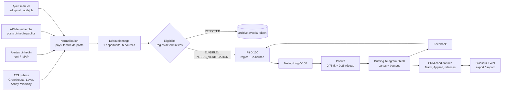

<div align="center">

# Summer Hunter 2027

**Un agent personnel qui trouve, filtre et classe les stages internationaux d'avril à août 2027.**

Il collecte la nuit sur des sources publiques autorisées, vérifie l'éligibilité avec des règles déterministes,
explique chaque score, repère les contacts utiles et livre un digest Telegram à 6 h.


</div>

---

## Ce qu'est Summer Hunter

Un outil local, sans serveur, qui tourne sur un Mac entre minuit et 6 h (heure de Paris) :

`sources publiques → normalisation → dédoublonnage → éligibilité (règles) → fit de carrière (règles + IA bornée) → networking → priorité → Telegram`

L'objectif n'est pas le volume. C'est de remonter les stages pertinents, réalisables et actionnables qu'on aurait ratés, en gardant visibles ceux qui sont prometteurs mais pas encore vérifiés.

## La promesse (et ses limites)

| Il fait | Il ne fait pas |
| --- | --- |
| Lit 34 flux officiels (Greenhouse, Lever, Ashby, Workday) vérifiés en direct | Scraper linkedin.com (interdit par son robots.txt) |
| Lit les emails d'alertes LinkedIn Jobs (dossier `.eml` ou IMAP en lecture seule) | Contourner un login, un CAPTCHA ou une protection anti-bot |
| Découvre des posts LinkedIn publics via une API de recherche autorisée | Prétendre surveiller tout LinkedIn Posts |
| Rejette France et Israël, les langues obligatoires non maîtrisées, les dates hors fenêtre | Déclarer ÉLIGIBLE un critère inconnu |
| Sépare fit, éligibilité et networking, et explique chaque score | Inventer une date, un visa, un contact ou une compétence |
| Garde les preuves (extraits, URL, date de vérification) | Envoyer un message à un recruteur ou postuler à ta place |
| Apprend de tes boutons Save / Dismiss / Applied, de façon lisible et réinitialisable | Se ré-entraîner de façon opaque |

## Comment ça marche



## Architecture « la douane et le jury »

- **La douane** (`engine/eligibility.py`) : treize critères (dont les exigences techniques obligatoires), chacun PASS, FAIL, UNKNOWN ou NOT_APPLICABLE, avec explication, preuve, URL, confiance et date. Elle ne note pas, elle laisse passer ou non. Un inconnu n'est jamais un PASS.
- **Le jury** (`engine/scoring.py`) : cinq composantes pondérées (alignement 30 %, expérience 25 %, mission 20 %, compétences 15 %, valeur long terme 10 %), pénalité cold calling, plafond pour les familles hors cible, préférences apprises.
- **Le témoin expert** (`engine/ai_analysis.py`) : le LLM extrait et commente, mais chaque exigence doit citer le texte mot pour mot, sinon elle est jetée. Il ne décide jamais l'éligibilité ; ses faits vérifiés repassent par la douane.
- **Le greffe** (`database/`) : SQLite, une opportunité canonique et toutes ses sources, l'historique des évaluations, des notifications et des coûts.

## Stack technique

| Domaine | Choix |
| --- | --- |
| Langage | Python 3.11+ (testé en 3.14), géré par `uv` |
| HTTP | HTTPX async, retries exponentiels, rate limit par hôte, robots.txt |
| Parsing | BeautifulSoup (HTML non fiable, scripts supprimés), JSON-LD schema.org |
| Modèles | Pydantic v2 |
| Stockage | SQLite + SQLAlchemy 2 (WAL, sauvegardes par l'API backup) |
| IA (optionnelle) | API Anthropic, sortie JSON contrainte par schéma, cache et plafond quotidien |
| Notifications | Telegram Bot API (HTML échappé, boutons inline) |
| Planification | launchd (LaunchAgent utilisateur) + `caffeinate` |
| CRM / Excel | OpenPyXL (graphiques natifs, import contrôlé, aucune macro) |

## Structure du dépôt

```
summer-hunter-2027/
├── config/
│   ├── candidate_profile.yaml   # seule source de vérité sur le candidat (UNKNOWN explicites)
│   ├── search_preferences.yaml  # pays exclus, priorités, filtres de titres, requêtes
│   ├── target_companies.yaml    # watchlist + jetons ATS vérifiés
│   ├── scoring_rules.yaml       # pondérations, familles, pénalités, seuils
│   └── llm.yaml                 # fournisseur, modèle, budget, tarifs
├── src/summer_hunter/
│   ├── collectors/              # une source = une classe, interface commune
│   ├── engine/                  # extraction, géo, éligibilité, scoring, réseau, IA, feedback
│   ├── integrations/            # Anthropic, Telegram, API de recherche, France Diplomatie
│   ├── notifications/           # digest et cartes, dédoublonnage des envois
│   ├── bot/                     # commandes et boutons Telegram (dont CRM)
│   ├── crm/                     # candidatures, contacts, journal, relances, export/import Excel
│   ├── database/                # schéma, dépôt, migrations, sauvegardes
│   ├── scheduler/               # fenêtre de nuit, verrou, LaunchAgents
│   ├── pipeline.py              # orchestration d'un cycle
│   └── cli.py                   # commande summer-hunter
├── tests/                       # unitaires, intégration (API simulées), live (-m live)
├── templates/                   # classeur CRM vide (structure de référence)
├── scripts/                     # install / uninstall macOS, run_once
└── docs/
```

### Le kit de docs (source de vérité)

| Fichier | Rôle |
| --- | --- |
| [docs/SETUP.md](docs/SETUP.md) | Installation, Telegram, Anthropic, planification, commandes |
| [docs/ARCHITECTURE.md](docs/ARCHITECTURE.md) | Flux de données, modules, schéma de base, sécurité |
| [docs/SCORING.md](docs/SCORING.md) | Règles d'éligibilité, calcul des scores, apprentissage |
| [docs/LINKEDIN_LIMITATIONS.md](docs/LINKEDIN_LIMITATIONS.md) | Ce qui est collecté sur LinkedIn, comment, et ce qui ne l'est pas |
| [docs/INDUSTRY_TRACK.md](docs/INDUSTRY_TRACK.md) | Piste Industrie & Robotique, recruitability, priorité industrielle |
| [docs/CRM.md](docs/CRM.md) | Suivi des candidatures, statuts, Excel, relances, documents |
| [docs/TROUBLESHOOTING.md](docs/TROUBLESHOOTING.md) | Pannes courantes et diagnostics |

## Démarrage

```bash
cd "summer-hunter-2027"
uv sync
cp .env.example .env && chmod 600 .env     # puis remplir Telegram (et Anthropic si voulu)
uv run summer-hunter init                  # base + validation de la config
uv run summer-hunter run --dry-run         # cycle complet sans rien écrire
uv run summer-hunter run                   # cycle réel
uv run summer-hunter list                  # classement
uv run summer-hunter digest --dry-run      # aperçu du message Telegram
scripts/install_macos.sh                   # planification nocturne (launchd)
```

## Doctrine & règles d'ingénierie

1. **Un inconnu reste UNKNOWN.** Ni le code ni le LLM ne remplissent un trou. ELIGIBLE exige des preuves positives.
2. **L'éligibilité est déterministe.** Le LLM apporte des citations vérifiées, les règles décident.
3. **Une exclusion confirmée est définitive.** Ni le score, ni le networking, ni le bypass stratégique ne la contournent.
4. **Tout contenu externe est une donnée hostile.** HTML assaini, prompt délimité, injections détectées, scores du modèle ignorés en cas de doute.
5. **Chaque score s'explique.** Composantes, ajustements, preuves et critères sont stockés et affichables (`show`, bouton Explain).
6. **Une source qui tombe ne fait pas tomber le cycle.** Isolation, timeouts, santé par source visible dans le digest.
7. **Accès autorisés uniquement.** robots.txt respecté, API publiques documentées, aucune évasion anti-bot.
8. **L'utilisateur garde la main.** Aucun envoi à un recruteur, aucune candidature automatique, préférences réinitialisables.
9. **Coûts bornés.** IA optionnelle, réservée à la shortlist, mise en cache, plafond quotidien en dollars.

## Limites

- **LinkedIn n'est pas surveillé en direct.** Seuls les emails d'alertes, les résultats d'une API de recherche (titre, URL, extrait) et les ajouts manuels entrent. Détails : [docs/LINKEDIN_LIMITATIONS.md](docs/LINKEDIN_LIMITATIONS.md).
- **Un Mac endormi ou éteint ne collecte rien.** launchd rattrape au réveil, le digest part alors en retard.
- **Beaucoup d'entreprises n'ont pas de flux public** (Google, Microsoft, SAP, Siemens, Schneider…) : elles ne remontent que via les alertes LinkedIn.
- **Tant que le profil contient des UNKNOWN** (nationalité, mois de diplôme, équivalence du diplôme), presque tout reste NEEDS_VERIFICATION. C'est voulu.
- **L'extraction par règles a des angles morts** (formulations rares, langues autres que l'anglais et le français). Le LLM les réduit sans les supprimer.
- **Les avis France Diplomatie** sont lus automatiquement mais jamais appliqués seuls : l'exclusion d'un pays reste une décision manuelle.
- **Telegram et Anthropic** sont testés contre des doubles de test ; leur fonctionnement réel dépend de tes clés.

## État du projet

- [x] Collecte ATS publique (34 flux vérifiés le 21 oct. 2026), alertes LinkedIn, API de recherche, ajout manuel
- [x] Éligibilité déterministe, scoring explicable, networking, priorité
- [x] Analyse IA bornée (Anthropic), cache, plafond de dépenses
- [x] Telegram : digest, cartes, commandes, boutons, feedback
- [x] Planification launchd, fenêtre de nuit, rattrapage, verrou
- [x] Piste Industrie & Robotique (maintenance, projets industriels, RaaS) avec score de recruitability, en parallèle de la piste Business
- [x] CRM des candidatures : Track/Applied, statuts validés, journal, relances, briefing quotidien, classeur Excel synchronisé
- [ ] Connexion de tes clés Telegram et Anthropic (étape manuelle)
- [ ] Remplir les UNKNOWN du profil (nationalité, mois de diplôme, équivalences)

---

<div align="center"><sub>Summer Hunter 2027 · outil personnel, local, sans infrastructure payante</sub></div>
