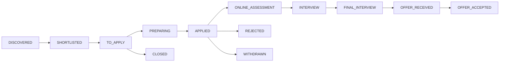

# CRM des candidatures

Summer Hunter ne fait plus seulement découvrir des offres : il suit chaque candidature, de la
découverte à l'offre. SQLite reste la source de vérité. Le classeur Excel est un miroir que tu
peux lire et corriger ; il n'est jamais indispensable (tout marche sans Excel installé).

## Principes

- **Une offre découverte n'est pas une candidature.** Un dossier CRM n'existe que si tu le crées :
  bouton **Track** (statut `TO_APPLY`) ou bouton **Applied** confirmé (statut `APPLIED`).
- **Rien n'est marqué envoyé sans toi.** Le bouton Applied demande une confirmation, la Mini App
  aussi ; dans Excel, saisir une *Date Applied* vaut confirmation explicite.
- **Rien n'est inventé.** Une date limite n'est retenue que si l'offre l'écrit en toutes lettres
  (jour, mois, année) ou si tu la saisis (`/deadline`). Les contacts viennent d'une preuve publique
  (moteur de networking, confiance ≥ 0,6) ou de ta saisie (`/contact`).
- **Rien n'est envoyé à un recruteur.** Les relances sont des suggestions.
- **L'historique est en ajout seul.** Chaque changement crée une ligne dans `crm_events` (feuille
  *Activity Log*) avec l'ancienne valeur, la nouvelle et la source (telegram, excel, miniapp, cli,
  system, migration).

## Statuts et transitions



Règles (`crm/statuses.py`) :

- On peut sauter des étapes vers l'avant (un recruteur peut appeler avant le test en ligne).
- On ne recule pas dans le pipeline (`FINAL_INTERVIEW` vers `APPLIED` est refusé) sauf correction
  forcée : `summer-hunter crm status APP-3 INTERVIEW --force`.
- Tout statut après candidature exige une date de candidature confirmée.
- `OFFER_ACCEPTED` exige `OFFER_RECEIVED`. `REJECTED`, `WITHDRAWN`, `CLOSED` et `OFFER_ACCEPTED` sont définitifs.
- Le statut le plus avancé jamais atteint est conservé (`furthest_status`) : un refus après
  entretien compte bien comme « a obtenu un entretien » dans les taux.

Les offres envoyées quittent les listes de découverte (Top, Nouveaux) ; Save et Dismiss ne peuvent
plus annuler une candidature envoyée.

## Telegram

Boutons sur chaque carte : **Save · Track · Applied · Dismiss** (Applied demande confirmation).

| Commande | Effet |
| --- | --- |
| `/crm` | Résumé chiffré et taux de conversion |
| `/applications` | Candidatures actives |
| `/applied` | Candidatures envoyées |
| `/interviews` | Entretiens à venir |
| `/followups` | Relances suggérées |
| `/deadlines` | Dates limites connues (et combien sont inconnues) |
| `/offers` | Offres reçues |
| `/company <nom>` | Candidatures pour une entreprise |
| `/export` | Génère et envoie le classeur Excel |
| `/sync` | Importe tes modifications du classeur local |
| `/setstatus APP-3 INTERVIEW` | Change un statut |
| `/interview APP-3 2026-11-05 14:00 [final]` | Enregistre un entretien |
| `/deadline APP-3 2026-11-15` | Fixe une date limite |
| `/next APP-3 2026-10-30 Relancer Jane` | Prochaine action et sa date |
| `/note APP-3 texte` | Ajoute une note datée |
| `/followed APP-3` | Note qu'une relance a été faite |
| `/contact APP-3 Nom \| Poste \| URL \| Recruiter` | Ajoute un contact |
| `/contactstatus C-1 MESSAGE_SENT` | Statut d'interaction d'un contact |

Envoyer au bot un fichier `.xlsx` du CRM l'importe directement (pratique depuis le téléphone).

## Classeur Excel

`data/crm/Summer_Hunter_2027_CRM.xlsx` (régénéré chaque nuit), modèle vide dans
`templates/Summer_Hunter_2027_CRM.xlsx`.

| Feuille | Contenu |
| --- | --- |
| Dashboard | Compteurs, taux de conversion, 5 graphiques natifs (statut, pays, famille, envois par semaine, entonnoir), date de synchro |
| Applications | Table principale, colonnes A à Z, filtres, volets figés, listes déroulantes, couleurs par statut, actions en retard en rouge, dates limites à 7 jours en orange, fit > 90 en vert |
| Networking | Contacts liés aux candidatures |
| Opportunities | Offres pertinentes détectées (pas forcément des candidatures) |
| Activity Log | Historique complet |

**Colonnes modifiables** (en-tête bleu clair) : Application Status, Date Applied, Next Action,
Next Action Date, Interview Date, Notes ; côté contacts : Interaction Status, Next Follow-up Date,
Next Action, Notes. Tout le reste (scores, URL, identifiants) est en lecture seule et ignoré à
l'import. Les nouvelles lignes sont ignorées : on crée un dossier par Telegram ou le CLI.

### Import : comment tes modifications sont fusionnées

À chaque export, les valeurs modifiables sont photographiées en base (`kv_state`, clé
`crm_export:<id>`). À l'import, chaque cellule est comparée à trois valeurs :

1. inchangée depuis l'export : ignorée, même si la base a bougé entre-temps (fichier ancien, pas de conflit) ;
2. modifiée dans Excel, base inchangée : appliquée ;
3. modifiée dans Excel **et** dans la base, avec des valeurs différentes : **conflit**. Rien n'est
   appliqué pour cette ligne ; Telegram propose « Appliquer Excel » ou « Garder la base »
   (CLI : `--prefer-excel`, ou `crm export` pour repartir de la base).

Garde-fous : sauvegarde de la base avant la première modification, copie du fichier importé dans
`data/crm/imports/`, refus des formules, des fichiers à macros et des identifiants en double,
validation des statuts et des dates, réimporter le même fichier ne change rien. Le classeur local
n'est jamais régénéré la nuit s'il contient des modifications non importées.

### Sécurité du fichier

Les textes venus d'Internet (titres, entreprises, notes) qui commencent par `= + - @` sont
neutralisés (apostrophe en tête) : Excel ne les exécute jamais comme formules. Seuls les liens
http(s) deviennent des hyperliens. Aucune logique métier ne dépend d'une formule : tous les chiffres
du tableau de bord sont calculés en Python.

## Relances et rappels

| Rappel | Quand | Anti-doublon |
| --- | --- | --- |
| Candidature sans réponse | 10 jours ouvrés après la candidature ou le dernier événement (changement de statut, relance) ; jamais après un refus | une fois par point de départ |
| Contact sans réponse | 5 jours ouvrés après un message envoyé | une fois par date d'interaction |
| Date limite | J-7, J-3, J-1, seulement pour une date future et confirmée | seul le seuil le plus serré franchi est envoyé |
| Lettre prête | quand une nouvelle version de lettre existe pour une candidature à préparer | une fois par version |

Les rappels partent dans le **briefing quotidien** (fin de la nuit), avec des boutons vers les
dossiers concernés. Un rappel n'est marqué envoyé que s'il apparaît dans le message.

## Documents

```
data/applications/<Entreprise>/<Poste>/
├── cv.pdf, cv.tex                 copie du dernier CV généré (data/cv/<id>/)
├── cover_letter.pdf, .tex         lettre générée
└── submitted-<AAAA-MM-JJ>/        copie figée au moment de la candidature + MANIFEST.txt
```

Chaque candidature garde le chemin, la date de génération et la version (incrémentée quand le
contenu change) du CV et de la lettre. À la confirmation d'envoi, les documents sont figés ; après
ça, plus aucune régénération automatique (un lien renvoyé au bot ne relance pas CV et lettre), et
les versions enregistrées ne bougent plus. Les candidatures enregistrées avant le CRM ont été figées
à leur première synchro, avec une mention dans le manifeste.

## CLI

```bash
summer-hunter crm summary | list | followups
summer-hunter crm track 123               # suivre l'opportunité #123
summer-hunter crm applied 123 --date 2026-10-20
summer-hunter crm status APP-3 INTERVIEW [--force]
summer-hunter crm export [--path out.xlsx]
summer-hunter crm import [fichier.xlsx] [--dry-run] [--prefer-excel]
summer-hunter crm template
```

## Schéma (v2)

`crm_applications` (une par opportunité suivie, unique), `crm_contacts`, `crm_events` (journal en
ajout seul), `crm_reminders` (rappels envoyés). La migration v2 est automatique au démarrage : les
lignes de l'ancienne table `applications` (bouton Applied) deviennent des dossiers `APPLIED` avec
leur vraie date ; l'ancienne table est conservée intacte.
